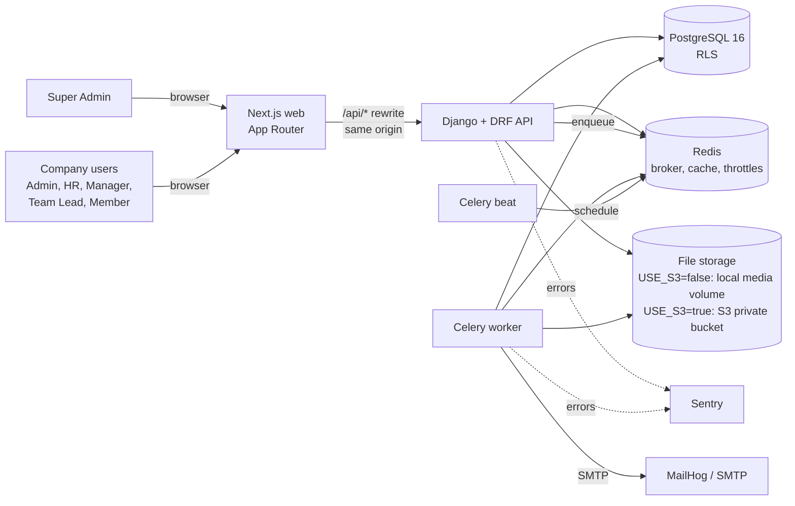
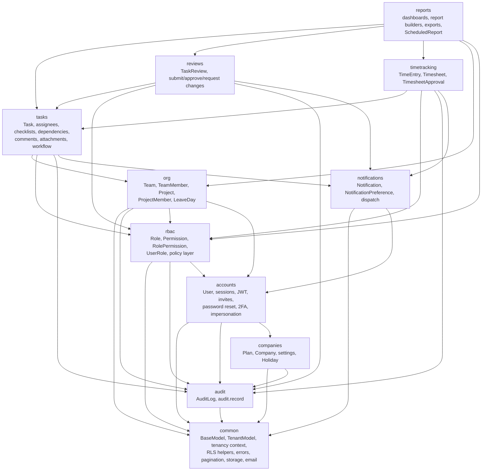
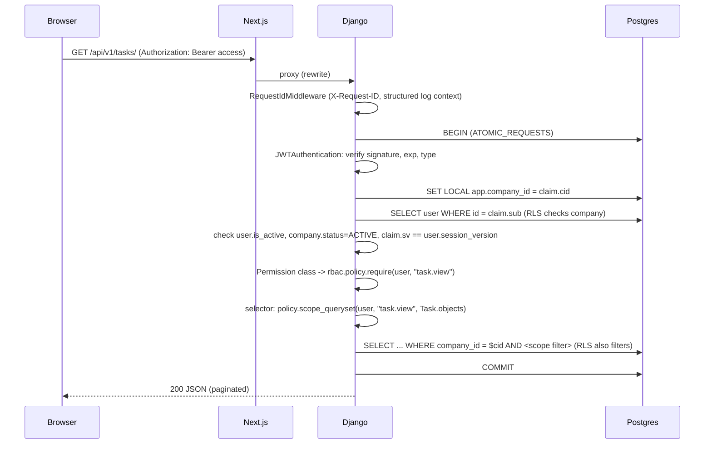

# 01. System Overview

## 1.1 Context



## 1.2 Backend modules

Each Django app owns its models, services, selectors, serializers, views and tests.
Arrows point from a module to the modules it imports. Cycles are not allowed.



Cross-module side effects that would create cycles (for example, `org` offboarding
flagging tasks for reassignment) go through Django signals declared in the
publishing module and handled in the consuming module's `handlers.py`.

## 1.3 Layering inside each app

```
views.py        Thin. Parse input with a serializer, call one service or selector,
                return an output serializer. No ORM queries, no business rules.
services.py     Business logic. Each public function is one use case, wrapped in
                transaction.atomic, takes `actor` explicitly, calls policy.require(),
                writes the audit record, enqueues side effects with
                transaction.on_commit.
selectors.py    Read queries. Always start from policy.scope_queryset(actor, perm, qs).
                select_related/prefetch_related live here.
models.py       Fields, constraints, indexes, tiny invariants. No cross-model logic.
serializers.py  Separate Input and Output serializers per endpoint.
permissions.py  DRF permission classes that delegate to rbac.policy.
tasks.py        Celery tasks. Receive IDs (never model instances), re-enter tenant context.
```

Rule enforced in review and by an import-linter contract in CI: `views` may import
`services`, `selectors`, `serializers`; never `models` managers directly for writes.

## 1.4 Request lifecycle



## 1.5 Tenancy design

### Layer 1: application

- `common.models.TenantModel` (abstract): `company = ForeignKey(Company, on_delete=PROTECT, db_index=True)`.
- Default manager `TenantManager` **raises `TenantContextMissing`** when used without an
  active tenant context, filters `company_id = current_company_id()` in TENANT mode, and
  returns all rows in PLATFORM mode. There is no unscoped manager; platform code enters
  `platform_context()` explicitly.
- `common.tenancy` holds a `ContextVar` for the active company and three context managers:
  - `tenant_context(company_id)`: normal request or Celery task for one company.
  - `platform_context()`: super admin endpoints (companies, plans, platform audit).
  - `auth_lookup_context()`: login, invite accept, password reset by token, refresh. It allows
    reading `accounts_user`, `accounts_invitetoken`, `accounts_passwordresettoken`,
    `accounts_usersession` across tenants and nothing else.
- Each context manager sets both the `ContextVar` and the Postgres settings below
  (`SELECT set_config(name, value, true)`), so Python and DB always agree.
- Services validate that every FK in input (assignee, team, project, reviewer, parent task)
  resolves inside the same company. Serializer `PrimaryKeyRelatedField`s use tenant-scoped
  querysets, so a foreign UUID returns "does not exist", not "forbidden" (no existence leak).

- Base views (`common.views.PublicAPIView`, `AuthenticatedAPIView`, `TenantAPIView`,
  `PlatformAPIView`) reset the database settings before authentication, so a request can
  only have the context its token proves. Public auth endpoints switch to the user's
  context only after the credentials or link token have been verified.
- OpenAPI generation runs in a Python-only platform state (`common.schema`) because it
  builds empty querysets for introspection; it never queries rows.

### Layer 2: PostgreSQL Row-Level Security

Roles (created by `docker/postgres/init/01-roles.sql`):

| Role | Attributes | Used by |
| --- | --- | --- |
| `postgres` | superuser | container bootstrap only |
| `tasktrack_owner` | owns database and all tables, `NOBYPASSRLS` | `migrate`, test database creation |
| `tasktrack_app` | `NOSUPERUSER NOBYPASSRLS`, not owner; `SELECT, INSERT, UPDATE, DELETE` on tables, `INSERT, SELECT` only on `audit_auditlog` | api, worker, beat |

Every tenant table gets, in a migration using `common.rls.tenant_rls(table)`:

```sql
ALTER TABLE tasks_task ENABLE ROW LEVEL SECURITY;
CREATE POLICY tenant_isolation ON tasks_task
  USING (
        company_id::text = current_setting('app.company_id', true)
     OR current_setting('app.platform', true) = 'on'
  )
  WITH CHECK (
        company_id::text = current_setting('app.company_id', true)
     OR current_setting('app.platform', true) = 'on'
  );
```

Account tables add a third read-only branch:
`OR (current_setting('app.auth_lookup', true) = 'on')` on a `FOR SELECT` policy.

Without any setting, `current_setting(..., true)` returns `NULL`, so **no rows are visible**.
A forgotten context fails closed. A CI test lists every model that subclasses `TenantModel`
and asserts `pg_class.relrowsecurity` is true and a `tenant_isolation` policy exists.

### Cross-tenant surfaces covered

| Surface | Control |
| --- | --- |
| List/detail endpoints | `TenantManager` + scope filter + RLS |
| Search and filters | Built on the same scoped queryset; `django-filter` FilterSets receive it |
| Reports and dashboards | Aggregations start from scoped selectors; RLS applies to raw SQL too |
| Exports | Generated by Celery inside `tenant_context(company_id)` captured at request time; file key prefixed with company id; download re-checks permission |
| File URLs | Keys `companies/<company_id>/...` in both backends. No storage URL reaches the browser: files are streamed only by the download endpoint after `policy.can(user, "task.view", task)`. The local media volume has no URL route; the S3 bucket is private |
| Background jobs | Task signature carries `company_id`; base Celery task class enters `tenant_context` |
| Mentions, assignees, reviewers | Validated against same-company scoped querysets |
| Impersonation | Token carries `cid` of target company, `imp` = super admin id; read-only; audited |

## 1.6 Authentication and session design

### Tokens

| Token | Lifetime | Storage | Claims |
| --- | --- | --- | --- |
| Access JWT | 10 min | JS memory only | `sub`, `cid` (company or null), `sv` (session_version), `sid` (UserSession id), `imp` (optional), `type=access` |
| Refresh JWT | 14 days, rotated on each use, old one blacklisted | httpOnly, `Secure`, `SameSite=Strict`, `Path=/api/v1/auth/` cookie `tt_refresh` | `sub`, `sid`, `sv`, `jti` |
| Session hint | Same lifetime as refresh | Non-httpOnly cookie `tt_session=1`, `Path=/`, `SameSite=Strict`. Not a credential: lets the Next.js proxy redirect anonymous page loads to `/login` | none |

- **Refresh reuse detection.** If a blacklisted refresh token is presented, the whole
  `UserSession` is revoked (token theft signal) and an audit event is written.
- **CSRF on cookie endpoints.** `/auth/refresh` and `/auth/logout` require the
  `X-CSRFToken` header to match the `csrftoken` cookie (Django double-submit) and an
  `Origin` in `CSRF_TRUSTED_ORIGINS`. All other endpoints use the bearer header, which
  is not sent automatically by browsers, so they are not CSRF-exposed.
- **Session version.** `User.session_version` increments on password change/reset,
  "log out everywhere", deactivation and role removal. Access tokens with an old `sv`
  are rejected immediately.
- **Sessions list.** `UserSession(id, user, created_at, last_used_at, ip, user_agent, revoked_at)`.
  Users see and revoke their own sessions; HR revokes all sessions of an employee on offboarding.

### Login protection

- Throttle: 5/min per IP+email and 20/min per IP (DRF `ScopedRateThrottle`, Redis cache).
- Lockout: after 10 consecutive failures, `locked_until = now + 15 min` (doubling up to 24 h).
  The response is the same generic "invalid credentials" for unknown email, wrong password
  and locked account, so accounts cannot be enumerated. Lockouts are audit-logged and
  emailed to the user.
- Suspended company or inactive user: generic failure, audit-logged.

### 2FA (TOTP)

- `pyotp`; secret encrypted at rest with Fernet (`FIELD_ENCRYPTION_KEY`).
- Enrolment returns an `otpauth://` URI for a QR code, confirmed with one valid code.
- 10 single-use recovery codes, stored hashed.
- If the company sets `enforce_2fa`, users without 2FA get a limited "enrolment-only"
  token after password login and can call only the 2FA setup endpoints.
- Login with 2FA is two-step: password returns `{mfa_required: true, mfa_token}` (5 min, signed),
  then `/auth/2fa/verify` returns the real tokens.

### Invite and reset tokens

- `secrets.token_urlsafe(32)` gives 256 bits. Only `sha256(token)` is stored.
- Lookup is by hash (constant-time by construction; the hash is the index key).
- Single use: `used_at` set inside `select_for_update`.
- Revocable (`revoked_at`), resendable (resend revokes previous open tokens and issues a new one).
- Invite expiry: company setting `invite_expiry_hours` (default 48). Reset expiry: 1 hour.
- The accept page shows a specific state: valid, expired, used, revoked. Expired, used and
  revoked all show "This link is no longer valid. Ask HR for a new link."
- Password policy: Django validators (min length 12, common password, numeric, user
  similarity) plus a class requiring 3 of 4 character classes. Applied on accept, change,
  reset and HR temporary passwords.

### HR password actions

| Action | Effect |
| --- | --- |
| Send reset link | New `PasswordResetToken`; email sent; existing sessions revoked; audit |
| Set temporary password | Password set, `must_change_password = true`; sessions revoked; employee emailed (without the password); audit. Until changed, the user may call only `/auth/me` and `/auth/password/change` |
| Restriction | Target's highest role `rank` must be strictly lower than the actor's (HR cannot reset HR, Company Admin or Super Admin). Data-driven, see 03-rbac.md |

### Impersonation

`POST /api/v1/platform/impersonations/` with `user_id` and mandatory `reason` creates an
`ImpersonationSession` and returns a 30-minute access token (no refresh token) with `imp`.
Middleware rejects non-`GET` methods while `imp` is present. Every request under
impersonation writes an `AuditLog` row with `actor = super admin`, `impersonated_user`, path.
The UI shows a persistent banner with an "End impersonation" button.
A failed impersonated request rolls back its transaction, so it cannot write an audit
row; it is recorded in the `tasktrack.security` structured log instead (nothing changed).

## 1.7 Cross-cutting concerns

| Concern | Design |
| --- | --- |
| Errors | One exception handler. Shape: `{"error": {"code", "message", "details", "request_id"}}` (see 05-api.md) |
| Logging | `structlog` JSON to stdout; fields `request_id`, `user_id`, `company_id`, `path`, `status`, `duration_ms`. A processor drops keys named `password`, `token`, `email`, `secret`, `authorization` |
| Sentry | `sentry-sdk` enabled when `SENTRY_DSN` set; `send_default_pii=False`; `before_send` strips request bodies |
| Health | `GET /health/live` (process up), `GET /health/ready` (DB, Redis, and storage: media dir writable, or S3 bucket reachable when `USE_S3=true`) |
| Settings | `django-environ`; all secrets from env; `prod.py` sets `SECURE_*`, HSTS, `SESSION_COOKIE_SECURE`, `CSRF_COOKIE_SECURE` |
| Time | All timestamps UTC in DB; company and user time zones applied in reports and UI |
| Soft delete | `Task.deleted_at`; default manager hides deleted rows; restore within 30 days; purge job afterwards |
| Email | Templated (`templates/email/*.html` + `.txt`), sent only from Celery via `transaction.on_commit` |
