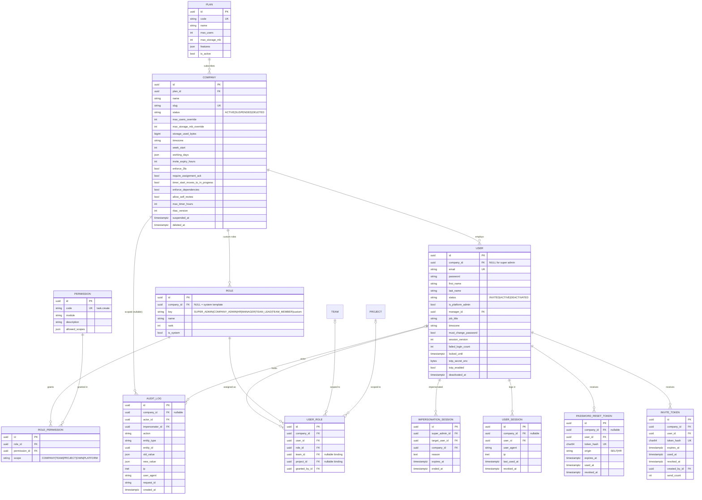

# 02. Data Model

Conventions:

- Every table has `id uuid PK`, `created_at timestamptz`, `updated_at timestamptz` (from `BaseModel`).
- **T** marks a tenant table: it has `company_id uuid NOT NULL` FK to `companies_company`,
  inherits `TenantModel`, and has the RLS policy from 01-system-overview.md section 1.5.
- Status and enum columns are `varchar` with `CHECK` constraints (Django `TextChoices` + `CheckConstraint`).
- FKs inside a tenant always point to rows of the same company. Services enforce this.
  Composite FKs are not used because Django does not support them cleanly; a nightly
  integrity job (`common.tasks.verify_tenant_integrity`) reports any mismatch.

## 2.1 ERD: platform, identity, RBAC

## 2.2 ERD: organisation, tasks, reviews, time, notifications, reports

```mermaid
erDiagram
    COMPANY ||--o{ TEAM : has
    TEAM ||--o{ TEAM_MEMBER : has
    USER ||--o{ TEAM_MEMBER : "member of"
    TEAM ||--o{ PROJECT : owns
    PROJECT ||--o{ PROJECT_MEMBER : has
    USER ||--o{ PROJECT_MEMBER : "member of"
    PROJECT ||--o{ TASK : contains
    TASK |o--o{ TASK : "parent of (subtasks)"
    TASK ||--o{ TASK_ASSIGNEE : "assigned to"
    USER ||--o{ TASK_ASSIGNEE : works
    TASK ||--o{ TASK_CHECKLIST : has
    TASK_CHECKLIST ||--o{ CHECKLIST_ITEM : has
    TASK ||--o{ TASK_DEPENDENCY : "is blocked by"
    TASK ||--o{ TASK_COMMENT : has
    TASK_COMMENT ||--o{ COMMENT_MENTION : mentions
    TASK ||--o{ TASK_ATTACHMENT : has
    TASK ||--o{ TASK_REVIEW : "reviewed in"
    TASK ||--o{ TASK_ACTIVITY : "history"
    COMPANY ||--o{ STATUS_TRANSITION_RULE : configures
    TASK ||--o{ TIME_ENTRY : "time logged"
    USER ||--o{ TIME_ENTRY : logs
    TIMESHEET ||--o{ TIME_ENTRY : groups
    TIMESHEET ||--o{ TIMESHEET_APPROVAL : decisions
    USER ||--o{ NOTIFICATION : receives
    USER ||--o{ NOTIFICATION_PREFERENCE : sets
    USER ||--o{ LEAVE_DAY : takes
    COMPANY ||--o{ HOLIDAY : observes
    COMPANY ||--o{ SCHEDULED_REPORT : schedules
    COMPANY ||--o{ REPORT_EXPORT : generates

    TEAM {
        uuid id PK
        uuid company_id FK
        string name
        uuid lead_id FK
        bool is_archived
    }
    TEAM_MEMBER {
        uuid id PK
        uuid company_id FK
        uuid team_id FK
        uuid user_id FK
        timestamptz joined_at
    }
    PROJECT {
        uuid id PK
        uuid company_id FK
        uuid team_id FK
        string key "WEB"
        string name
        string status "ACTIVE|ON_HOLD|COMPLETED|ARCHIVED"
        uuid owner_id FK
        int task_seq
        date start_date
        date end_date
    }
    PROJECT_MEMBER {
        uuid id PK
        uuid company_id FK
        uuid project_id FK
        uuid user_id FK
    }
    TASK {
        uuid id PK
        uuid company_id FK
        uuid project_id FK
        uuid parent_id FK
        int number "per project, WEB-42"
        string title
        text description
        text instructions
        text acceptance_criteria
        string priority "LOW|MEDIUM|HIGH|URGENT"
        string status
        date start_date
        date due_date
        int estimated_minutes
        uuid created_by_id FK
        uuid reviewer_id FK
        text blocked_reason
        int review_round
        bool needs_reassignment
        timestamptz completed_at
        timestamptz locked_at
        int version
        timestamptz deleted_at
    }
    TASK_ASSIGNEE {
        uuid id PK
        uuid company_id FK
        uuid task_id FK
        uuid user_id FK
        uuid assigned_by_id FK
        timestamptz acknowledged_at
    }
    TASK_CHECKLIST {
        uuid id PK
        uuid company_id FK
        uuid task_id FK
        string title
        int position
    }
    CHECKLIST_ITEM {
        uuid id PK
        uuid company_id FK
        uuid checklist_id FK
        string text
        bool is_required
        bool is_done
        uuid done_by_id FK
        timestamptz done_at
        int position
    }
    TASK_DEPENDENCY {
        uuid id PK
        uuid company_id FK
        uuid task_id FK "blocked task"
        uuid blocked_by_id FK "blocking task"
    }
    TASK_COMMENT {
        uuid id PK
        uuid company_id FK
        uuid task_id FK
        uuid author_id FK
        text body
        string kind "COMMENT|REVIEW|SYSTEM"
        timestamptz edited_at
        timestamptz deleted_at
    }
    COMMENT_MENTION {
        uuid id PK
        uuid company_id FK
        uuid comment_id FK
        uuid user_id FK
    }
    TASK_ATTACHMENT {
        uuid id PK
        uuid company_id FK
        uuid task_id FK
        uuid comment_id FK
        string storage_key
        string filename
        string content_type
        bigint size_bytes
        char64 sha256
        string status "PENDING|ACTIVE|REJECTED|DELETED"
        uuid uploaded_by_id FK
    }
    TASK_REVIEW {
        uuid id PK
        uuid company_id FK
        uuid task_id FK
        int round
        uuid submitted_by_id FK
        timestamptz submitted_at
        text submission_note
        uuid reviewer_id FK
        string decision "PENDING|APPROVED|CHANGES_REQUESTED|CANCELLED"
        text comment
        timestamptz decided_at
    }
    TASK_ACTIVITY {
        uuid id PK
        uuid company_id FK
        uuid task_id FK
        uuid actor_id FK
        string verb
        json data
    }
    STATUS_TRANSITION_RULE {
        uuid id PK
        uuid company_id FK
        string from_status
        string to_status
        json allowed_roles
        bool requires_comment
        bool requires_reviewer
        string trigger "MANUAL|SUBMIT|APPROVE|REQUEST_CHANGES|TIMER|ASSIGN|SYSTEM"
        bool is_active
    }
    TIME_ENTRY {
        uuid id PK
        uuid company_id FK
        uuid user_id FK
        uuid task_id FK
        uuid timesheet_id FK
        timestamptz started_at
        timestamptz ended_at
        int duration_seconds
        date work_date
        string source "TIMER|MANUAL"
        string status "RUNNING|DRAFT|SUBMITTED|APPROVED|REJECTED"
        text note
        int version
    }
    TIMESHEET {
        uuid id PK
        uuid company_id FK
        uuid user_id FK
        date period_start
        date period_end
        string status "OPEN|SUBMITTED|APPROVED|REJECTED"
        int total_seconds
        timestamptz submitted_at
    }
    TIMESHEET_APPROVAL {
        uuid id PK
        uuid company_id FK
        uuid timesheet_id FK
        uuid approver_id FK
        string decision "APPROVED|REJECTED"
        text comment
    }
    NOTIFICATION {
        uuid id PK
        uuid company_id FK
        uuid recipient_id FK
        string event_type
        string title
        text body
        string entity_type
        uuid entity_id
        timestamptz read_at
        timestamptz emailed_at
    }
    NOTIFICATION_PREFERENCE {
        uuid id PK
        uuid company_id FK
        uuid user_id FK
        string event_type
        bool in_app
        bool email
    }
    LEAVE_DAY {
        uuid id PK
        uuid company_id FK
        uuid user_id FK
        date date
        string kind "ANNUAL|SICK|UNPAID|OTHER"
        bool half_day
    }
    HOLIDAY {
        uuid id PK
        uuid company_id FK
        date date
        string name
    }
    SCHEDULED_REPORT {
        uuid id PK
        uuid company_id FK
        uuid owner_id FK
        string report_type
        json filters
        string format "CSV|XLSX|PDF"
        string frequency "DAILY|WEEKLY|MONTHLY"
        time send_at
        json recipient_ids
        timestamptz next_run_at
        bool is_active
    }
    REPORT_EXPORT {
        uuid id PK
        uuid company_id FK
        uuid requested_by_id FK
        uuid scheduled_report_id FK
        string report_type
        json filters
        string format
        string status "QUEUED|RUNNING|READY|FAILED"
        string storage_key
        timestamptz expires_at
    }
```

## 2.3 Table notes

### companies

| Table | Notes |
| --- | --- |
| `companies_plan` | Not tenant-scoped. Platform-managed. `features` JSON (for example `{"reports_pdf": true, "scheduled_reports": true}`). |
| `companies_company` | Not a tenant table itself, but RLS policy: `id::text = app.company_id OR app.platform = 'on'`. Effective limits = override if set, else plan value. `storage_used_bytes` updated atomically (`F()` expression) when attachments become ACTIVE or DELETED. Upload initiation fails with `storage_limit_exceeded` when it would pass the limit. User creation fails with `user_limit_exceeded` when active+invited users reach `max_users`. |

### accounts

| Table | Notes |
| --- | --- |
| `accounts_user` | `email` stored lower-case, unique on `lower(email)`. `CHECK (is_platform_admin = (company_id IS NULL))`. `password` unusable while INVITED. RLS: company match, platform, or `auth_lookup` (SELECT only). |
| `accounts_invitetoken` | **T**. Partial unique index: one open token per user `WHERE used_at IS NULL AND revoked_at IS NULL`. |
| `accounts_passwordresettoken` | **T** via `company_id` (nullable for super admin; platform policy branch). |
| `accounts_usersession` | Refresh-token family. `outstanding/blacklisted` JWTs from `rest_framework_simplejwt.token_blacklist` link here via `jti`. |
| `accounts_recoverycode` | `user_id`, `code_hash`, `used_at`. |
| `accounts_impersonationsession` | Platform table (platform policy only). |

### rbac

| Table | Notes |
| --- | --- |
| `rbac_permission` | Global catalogue, seeded by data migration, read-only at runtime. `allowed_scopes` limits which scopes a role may grant (for example `employee.reset_password` allows only `COMPANY`). |
| `rbac_role` | `company_id NULL` rows are system templates. On company creation the six templates are copied into company rows (`is_system = true`, key preserved). Unique `(company, key)`. `rank`: SUPER_ADMIN 100, COMPANY_ADMIN 90, HR 70, MANAGER 50, TEAM_LEAD 30, TEAM_MEMBER 10. |
| `rbac_rolepermission` | Unique `(role, permission)`. `CHECK scope IN (...)` and service-level check against `permission.allowed_scopes`. |
| `rbac_userrole` | **T**. Unique `(user, role, team, project)` with `NULLS NOT DISTINCT` (Postgres 15+). `CHECK NOT (team_id IS NOT NULL AND project_id IS NOT NULL)`. Setting a team lead creates a `TEAM_LEAD` row bound to that team. |

### org

| Table | Notes |
| --- | --- |
| `org_team` | **T**. Unique `(company, lower(name))`. `lead_id` is display info; authority comes from `UserRole(TEAM_LEAD, team=...)`, kept in sync by `org.services.set_team_lead`. |
| `org_teammember` | **T**. Unique `(team, user)`. |
| `org_project` | **T**. Unique `(company, upper(key))`. `task_seq` incremented with `select_for_update` to allocate `Task.number`. |
| `org_projectmember` | **T**. Unique `(project, user)`. Assignees must be project members (auto-added when a manager assigns a team member). |
| `org_leaveday` | **T**. Unique `(user, date)`. |
| `org_holiday` | **T**. Unique `(company, date)`. Lives in `org` with leave (both feed workload capacity). |

### tasks

| Table | Notes |
| --- | --- |
| `tasks_task` | **T**. Unique `(project, number)`. `parent_id` must be in the same project; depth limited to 3 levels. `CHECK due_date >= start_date`. `CHECK estimated_minutes >= 0`. Status written only by `tasks.workflow.transition_task()` (enforced by a `pre_save` guard comparing to the DB value unless a context flag is set, plus a test). `version` incremented on every update; updates use `UPDATE ... WHERE id=? AND version=?`. `locked_at` set on approval; locked tasks reject edits except reopen. |
| `tasks_taskassignee` | **T**. Unique `(task, user)`. |
| `tasks_taskchecklist`, `tasks_checklistitem` | **T**. Submit-for-review requires all `is_required` items done. |
| `tasks_taskdependency` | **T**. Unique `(task, blocked_by)`. `CHECK task_id <> blocked_by_id`. Cycle detection: `pg_advisory_xact_lock(hashtext(company_id))` then recursive CTE from `blocked_by` following `blocked_by` edges; reject if it reaches `task`. Both tasks must be in the same company (may be different projects). |
| `tasks_taskcomment` | **T**. Body is plain text, rendered escaped (no Markdown or HTML interpretation). Mentions are tokens `@[Display](user:<uuid>)`, parsed server-side, validated against users who can view the task. |
| `tasks_commentmention` | **T**. Unique `(comment, user)`. |
| `tasks_taskattachment` | **T**. `storage_key = companies/<company_id>/tasks/<task_id>/<attachment_id>/<safe_filename>`. Created ACTIVE after validation (allow-list, size, content sniff, quota); DELETED rows keep history, the object is removed on commit. |
| `tasks_taskactivity` | **T**. Append-only user-facing history (created, assigned, status changed, field edited, comment added, review decision, time logged). Separate from `AuditLog`, which is the security record. |

### reviews

| Table | Notes |
| --- | --- |
| `reviews_taskreview` | **T**. Unique `(task, round)`. Partial unique `(task) WHERE decision = 'PENDING'` (one open review). Rows are never updated after `decided_at` is set. |

### workflow

| Table | Notes |
| --- | --- |
| `tasks_statustransitionrule` | **T**. Unique `(company, from_status, to_status, trigger)`. Seeded per company from `tasks/workflow_defaults.py`. COMPANY_ADMIN and HR (permission `workflow.manage`) can toggle `is_active`, `allowed_roles`, `requires_comment`. Core-integrity rules (`IN_REVIEW -> COMPLETED` via APPROVE etc.) have `is_locked = true` and cannot be deleted. |

### timetracking

| Table | Notes |
| --- | --- |
| `timetracking_timeentry` | **T**. Partial unique index `(user) WHERE ended_at IS NULL` enforces one running timer per user at DB level. `CHECK ended_at IS NULL OR ended_at > started_at`. `duration_seconds` computed on stop. `work_date` = start date in user's time zone. Entries in SUBMITTED/APPROVED timesheets are immutable. Manual entries may not overlap the user's other entries (`EXCLUDE USING gist (user_id WITH =, tstzrange(started_at, ended_at) WITH &&)` with `btree_gist`). |
| `timetracking_timesheet` | **T**. Unique `(user, period_start)`. |
| `timetracking_timesheetapproval` | **T**. Append-only decisions. |

### notifications, reports, audit

| Table | Notes |
| --- | --- |
| `notifications_notification` | **T**. Index `(recipient, read_at, created_at desc)`. Retained 180 days. |
| `notifications_notificationpreference` | **T**. Unique `(user, event_type)`. Missing row = defaults from `notifications/events.py`. |
| `reports_scheduledreport` | **T**. Recipients must be company users with `report.view` for the report scope. |
| `reports_reportexport` | **T**. Files expire after 7 days (beat job deletes object and row). |
| `audit_auditlog` | Not a `TenantModel` (company nullable) but has RLS: `company_id::text = app.company_id OR app.platform = 'on'`. Trigger `audit_no_update_delete` raises on `UPDATE`/`DELETE`. Runtime role has `INSERT, SELECT` only. Index `(company_id, created_at desc)`, `(entity_type, entity_id)`, `(actor_id, created_at desc)`. Partitioned by month is a later optimisation, not needed now. |

## 2.4 Required indexes

| Index | Purpose |
| --- | --- |
| `tasks_task (company_id, status) WHERE deleted_at IS NULL` | Dashboards, kanban |
| `tasks_task (company_id, due_date) WHERE deleted_at IS NULL` | Overdue, calendar |
| `tasks_task (project_id, status)` | Project board |
| `tasks_task (parent_id)` | Subtasks |
| `tasks_taskassignee (user_id, task_id)` + `tasks_task (status)` covered by a denormalised `status` column on assignee | "Assignee, status" for My Tasks; `tasks_taskassignee.task_status` kept in sync inside `transition_task()` and indexed `(user_id, task_status)` |
| `timetracking_timeentry (user_id, work_date)` | Timesheets, personal reports |
| `timetracking_timeentry (company_id, work_date)` | Company reports |
| `timetracking_timeentry (task_id)` | Task time log |
| `rbac_userrole (user_id)` | Policy resolution |
| `notifications_notification (recipient_id, read_at, created_at desc)` | Unread badge |
| `audit_auditlog (company_id, created_at desc)` | Audit search |
| GIN trigram on `tasks_task.title` (`pg_trgm`) | Task search |

## 2.5 RLS coverage

Every table marked **T**, plus `companies_company`, `accounts_user`,
`accounts_passwordresettoken`, `accounts_usersession`, `accounts_recoverycode`,
`accounts_impersonationsession` and `audit_auditlog`, has RLS enabled.
Tables without RLS: `companies_plan`, `rbac_permission`, system rows of `rbac_role`
(policy allows `company_id IS NULL` for SELECT), Django internals (`django_migrations`,
`django_content_type`, `token_blacklist_*` linked to sessions).
