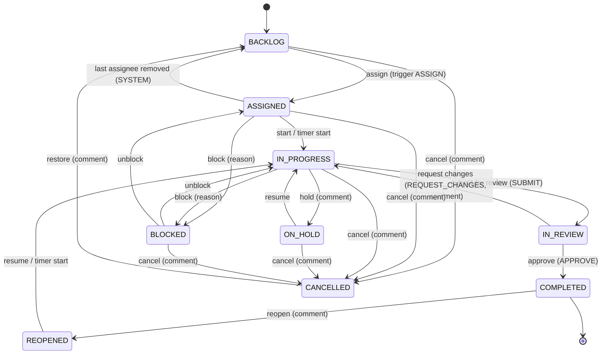
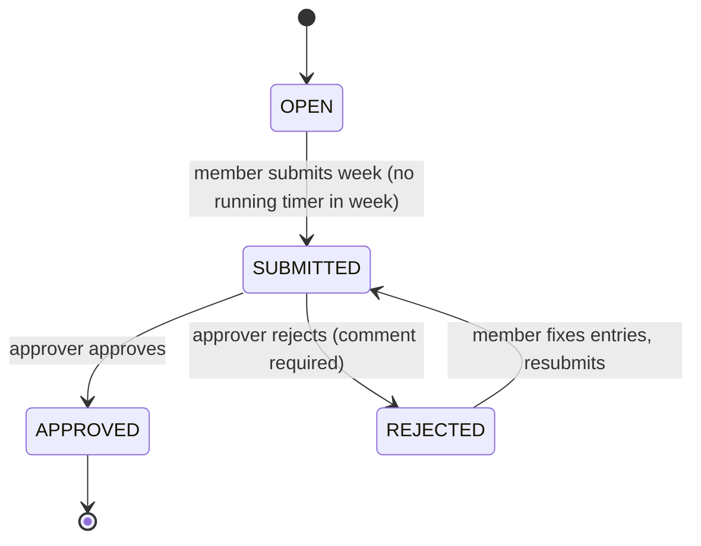

# 04. Task Lifecycle, Review and Time Tracking

## 4.1 Statuses

| Status | Meaning | Editable fields | Timer allowed |
| --- | --- | --- | --- |
| `BACKLOG` | Created, no assignee | all | no |
| `ASSIGNED` | Has at least one assignee, work not started | all | starting a timer moves to `IN_PROGRESS` when company setting `timer_start_moves_to_in_progress` is on |
| `IN_PROGRESS` | Work under way | all | yes |
| `IN_REVIEW` | Submitted, waiting for reviewer | none (fields, priority and checklists frozen, `task_in_review`); comments and attachments allowed | no (running timers are stopped on submit) |
| `ON_HOLD` | Paused deliberately | all | no |
| `BLOCKED` | Cannot proceed; `blocked_reason` required | all | no |
| `REOPENED` | Completed task reopened; reason logged | all | starting a timer moves to `IN_PROGRESS` |
| `COMPLETED` | Approved. `locked_at` set. Read-only | none (reopen only) | no |
| `CANCELLED` | Abandoned. Read-only | none (restore only) | no |

## 4.2 State diagram (default rules)



## 4.3 Default transition table (seeded per company)

`allowed_roles` lists role keys. The actor must hold one of these roles **and**
`task.transition` (or the trigger's own permission) at a scope covering the task.
`TEAM_MEMBER` transitions additionally require the actor to be an assignee
(that is what `OWN` scope means for tasks). Locked rows cannot be disabled by companies.

| # | From | To | Trigger | Allowed roles | Comment required | Reviewer required | Locked |
| --- | --- | --- | --- | --- | --- | --- | --- |
| 1 | BACKLOG | ASSIGNED | ASSIGN | COMPANY_ADMIN, MANAGER, TEAM_LEAD | no | no | yes |
| 2 | ASSIGNED | BACKLOG | SYSTEM | (system: last assignee removed) | no | no | yes |
| 3 | ASSIGNED | IN_PROGRESS | MANUAL | COMPANY_ADMIN, MANAGER, TEAM_LEAD, TEAM_MEMBER | no | no | no |
| 4 | ASSIGNED | IN_PROGRESS | TIMER | TEAM_MEMBER, TEAM_LEAD, MANAGER, COMPANY_ADMIN | no | no | no |
| 5 | IN_PROGRESS | IN_REVIEW | SUBMIT | TEAM_MEMBER, TEAM_LEAD, MANAGER | no | yes | yes |
| 6 | IN_REVIEW | COMPLETED | APPROVE | MANAGER, COMPANY_ADMIN (+ TEAM_LEAD if granted `review.decide`) | no | yes | yes |
| 7 | IN_REVIEW | IN_PROGRESS | REQUEST_CHANGES | MANAGER, COMPANY_ADMIN (+ TEAM_LEAD if granted) | **yes** | yes | yes |
| 8 | IN_PROGRESS | ON_HOLD | MANUAL | COMPANY_ADMIN, MANAGER, TEAM_LEAD | yes | no | no |
| 9 | ON_HOLD | IN_PROGRESS | MANUAL | COMPANY_ADMIN, MANAGER, TEAM_LEAD | no | no | no |
| 10 | ASSIGNED | BLOCKED | MANUAL | COMPANY_ADMIN, MANAGER, TEAM_LEAD, TEAM_MEMBER | **yes (reason)** | no | yes |
| 11 | IN_PROGRESS | BLOCKED | MANUAL | COMPANY_ADMIN, MANAGER, TEAM_LEAD, TEAM_MEMBER | **yes (reason)** | no | yes |
| 12 | BLOCKED | IN_PROGRESS | MANUAL | COMPANY_ADMIN, MANAGER, TEAM_LEAD | no | no | no |
| 13 | BLOCKED | ASSIGNED | MANUAL | COMPANY_ADMIN, MANAGER, TEAM_LEAD | no | no | no |
| 14 | COMPLETED | REOPENED | MANUAL | COMPANY_ADMIN, MANAGER | **yes** | no | yes |
| 15 | REOPENED | IN_PROGRESS | MANUAL | COMPANY_ADMIN, MANAGER, TEAM_LEAD, TEAM_MEMBER | no | no | no |
| 16 | REOPENED | IN_PROGRESS | TIMER | COMPANY_ADMIN, MANAGER, TEAM_LEAD, TEAM_MEMBER | no | no | no |
| 17-21 | BACKLOG, ASSIGNED, IN_PROGRESS, ON_HOLD, BLOCKED | CANCELLED | MANUAL | COMPANY_ADMIN, MANAGER | yes | no | no |
| 22 | CANCELLED | BACKLOG | MANUAL | COMPANY_ADMIN, MANAGER | yes | no | no |

Rules marked "requires_comment" for `BLOCKED` store the comment as `Task.blocked_reason`
and as a `TaskComment(kind=SYSTEM)`.

## 4.4 `transition_task()` contract

`apps/tasks/workflow.py`, the **only** code allowed to change `Task.status`.

```python
def transition_task(
    *, actor, task_id, to_status, trigger="MANUAL",
    comment: str = "", expected_version: int | None = None, request_meta=None,
) -> Task:
```

Steps, all inside `transaction.atomic()`:

1. `Task.objects.select_for_update().get(id=task_id)` (tenant-scoped, RLS-protected).
2. `policy.require(actor, "task.view", task)` (404 if not visible).
3. If `expected_version` is given and differs: raise `ConcurrencyConflict` (409).
4. Find an active `StatusTransitionRule(from=task.status, to=to_status, trigger=trigger)`.
   None: raise `InvalidTransition` (409, `details.allowed` lists valid targets for this actor).
5. Check actor holds a role in `rule.allowed_roles` with a grant covering the task
   (via `policy`), unless `trigger == SYSTEM`.
6. `requires_comment` and empty comment: `ValidationError` (400).
7. `requires_reviewer` and no effective reviewer: `ValidationError`.
8. Guards per target:
   - `IN_PROGRESS` with `company.enforce_dependencies`: every `blocked_by` task is
     `COMPLETED` or `CANCELLED`, else `DependencyBlocked` (409, lists blockers).
   - `IN_REVIEW`: required checklist items done; caller must be `reviews.services.submit`.
   - `COMPLETED`: caller must be `reviews.services.approve`.
   - Leaving `IN_PROGRESS`: stop running timers on this task (each assignee), closing entries at `now`.
9. Write status, set `completed_at`/`locked_at`/`blocked_reason` as needed, `version += 1`.
   Sync `TaskAssignee.task_status`.
10. `TaskActivity(verb="status_changed", data={from, to, comment})`, `TaskComment(kind=SYSTEM)` when a comment was given.
11. `audit.record(actor, "task.transition", task, old={"status": from}, new={"status": to})`.
12. `transaction.on_commit(notify...)` for assignees, reviewer, creator per event preferences.

Direct status writes are blocked by a `pre_save` guard (raises unless the
`workflow._writing` context flag is set) and covered by tests.

## 4.5 Blocked and escalation

- `BLOCKED` requires a reason (rules 10, 11).
- `POST /tasks/{id}/escalate/` (`task.escalate`, TEAM_LEAD) only on `BLOCKED` tasks:
  notifies the project owner and every MANAGER whose scope covers the task, records
  `TaskActivity(verb="escalated")` and audit. Repeat escalation within 1 hour is rejected (429-style `escalation_throttled`).
- A beat job notifies managers of tasks blocked longer than 48 h (once per day).

## 4.6 Review workflow (`apps/reviews`)

Separate app, tables and endpoints. Shares nothing with timesheet approval.

```mermaid
sequenceDiagram
    actor M as Member (assignee)
    participant R as reviews.services
    participant W as tasks.workflow
    actor V as Reviewer
    M->>R: submit(task, note)
    R->>R: require review.submit, required checklist complete,<br/>no PENDING review open
    R->>R: TaskReview(round = task.review_round + 1, decision=PENDING, reviewer=effective reviewer)
    R->>W: transition_task(IN_PROGRESS -> IN_REVIEW, trigger=SUBMIT)
    R-->>V: notification "review requested"
    alt approve
        V->>R: approve(review, comment?)
        R->>R: require review.decide + is effective reviewer (or COMPANY scope)
        R->>W: transition_task(IN_REVIEW -> COMPLETED, trigger=APPROVE)
        R->>R: decision=APPROVED, decided_at; task.locked_at = now
        R-->>M: notification "approved"
    else request changes
        V->>R: request_changes(review, comment required)
        R->>W: transition_task(IN_REVIEW -> IN_PROGRESS, trigger=REQUEST_CHANGES, comment)
        R->>R: decision=CHANGES_REQUESTED
        R-->>M: notification "changes requested"
    end
```

Rules:

- Effective reviewer: `task.reviewer` if set, else `task.created_by`. A reviewer cannot
  review a task they are assigned to (self-review blocked) unless they hold `review.decide`
  at COMPANY scope and the company setting `allow_self_review` is on (default off).
- `round` increases on each submission. History endpoint returns all rounds ordered.
- When a review is decided the row is final. Reopening a completed task cancels nothing in
  history; the next submission opens a new round.
- Approval locks the task (`locked_at`). Edits, comments, attachments, checklist changes and
  time entries on a locked task are rejected with `task_locked` (409). Only `task.reopen`
  unlocks (rule 14), which clears `locked_at` and records the reason.
- Final activity history is preserved: `TaskActivity` and `TaskReview` rows are never
  deleted, even when the task is soft-deleted.

## 4.7 Timer rules (`apps/timetracking`)

| Rule | Implementation |
| --- | --- |
| One running timer per user | Partial unique index `timeentry(user_id) WHERE ended_at IS NULL`; service takes `select_for_update` on the user's row first, so concurrent starts serialise and the loser gets `timer_already_running` (409) with the running entry |
| Timer only in `IN_PROGRESS` | Start on `ASSIGNED`/`REOPENED` calls `transition_task(..., trigger=TIMER)` when the company setting is on, else `409 task_not_in_progress` |
| Only assignees | `time.track` OWN + assignee check |
| Persist across refresh/devices | Server stores `started_at`; `GET /time/timer/current/` returns it; UI computes elapsed from server time offset |
| Pause | Closes the running entry (`ended_at = now`) and marks `task_id` as resumable in the response |
| Resume | Starts a new entry on the same task (same checks as start) |
| Stop | Closes the entry; `duration_seconds = ended_at - started_at` |
| Auto-stop | Leaving `IN_PROGRESS` stops timers on that task. Beat job stops timers running longer than `company.max_timer_hours` (default 12) and notifies the user |
| Manual entries | `started_at`/`ended_at`; no overlap (exclusion constraint `timeentry_no_overlap`); not in the future; at most 24 h; not in a SUBMITTED/APPROVED timesheet week; not on completed/cancelled tasks |
| Switching task | Starting a timer on task B while A runs returns 409; the UI offers "stop A and start B", which calls `POST /time/timer/switch/` (atomic stop + start) |

## 4.8 Timesheet workflow (separate from review)



- Timesheet rows are created lazily for the week of each entry.
- Submit sets entries to `SUBMITTED`, approval to `APPROVED`, rejection back to `DRAFT`.
- Approver: holder of `timesheet.approve` covering the user (TEAM scope for managers);
  default target is `user.manager`. Approvers cannot approve their own timesheet.
- Each decision is an append-only `TimesheetApproval` row and an audit record.
- Implemented in `timetracking/services/timesheets.py`; it does not import `reviews`.
