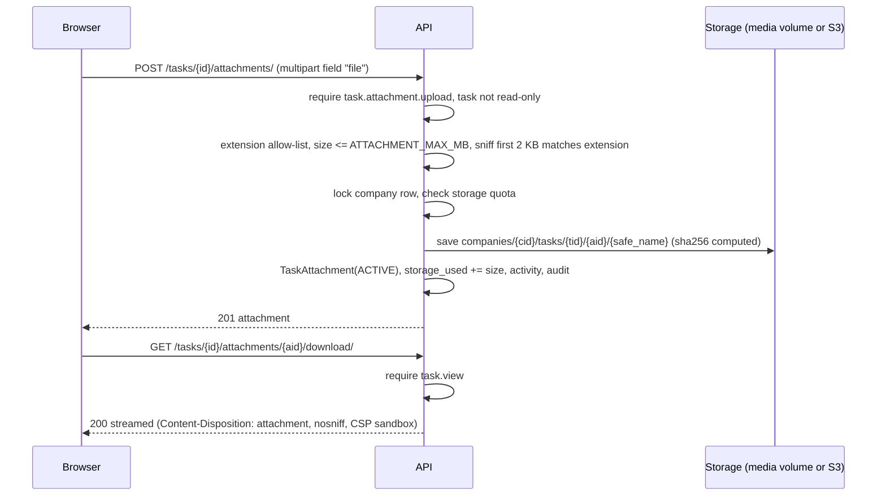

# 05. REST API

Base path `/api/v1/`. JSON only. OpenAPI 3.1 schema at `/api/v1/schema/`, Swagger UI at
`/api/v1/docs/`, ReDoc at `/api/v1/redoc/`. Schema is generated by drf-spectacular and
checked into `frontend/openapi.json` in CI (diff must be empty) so the generated client
never drifts.

## 5.1 Conventions

| Topic | Rule |
| --- | --- |
| Auth | `Authorization: Bearer <access>` on every endpoint except those marked **public** |
| IDs | UUIDs in paths. Tasks also accept the human key `WEB-42` at `GET /tasks/by-key/{key}/` |
| Pagination | Cursor pagination for feeds (activity, notifications, audit): `?cursor=`. Page-number for tables: `?page=&page_size=` (max 100). Response `{"count", "next", "previous", "results"}` |
| Filtering | `django-filter`. Each list documents its fields, for example `?status=IN_PROGRESS&status=BLOCKED&assignee=<id>&due_before=2026-12-01` |
| Ordering | `?ordering=-due_date,priority` with an allow-list per endpoint |
| Search | `?search=` on an allow-list of fields (trigram on task title) |
| Concurrency | Task and TimeEntry `PATCH` require `version` in the body (or `If-Match: "<version>"`). Mismatch returns 409 `version_conflict` with the current object |
| Idempotency | `POST` endpoints that create side effects (invites, exports, timer start) accept `Idempotency-Key`; replays within 24 h return the first response |
| Rate limits | `login` 5/min per IP+email, `password_reset` 3/h per email, `invite_accept` 10/min per IP, authenticated users 600/min, exports 10/h per user |
| Time | ISO 8601 UTC in responses; dates as `YYYY-MM-DD` |
| Audit | Every non-GET endpoint writes at least one `AuditLog` row in the same transaction |

### Error format

```json
{
  "error": {
    "code": "invalid_transition",
    "message": "Cannot move task from COMPLETED to IN_PROGRESS.",
    "details": {"allowed": ["REOPENED"]},
    "request_id": "01JF3Q…"
  }
}
```

Validation errors use `code: "validation_error"` and `details: {"field": ["message"]}`.

| HTTP | Codes |
| --- | --- |
| 400 | `validation_error`, `comment_required`, `checklist_incomplete`, `weak_password` |
| 401 | `not_authenticated`, `token_invalid`, `token_expired`, `session_revoked`, `mfa_required` |
| 403 | `permission_denied`, `password_change_required`, `impersonation_read_only`, `company_suspended`, `mfa_enrolment_required` |
| 404 | `not_found` (also for other tenants' objects) |
| 409 | `version_conflict`, `invalid_transition`, `task_locked`, `dependency_cycle`, `dependency_blocked`, `timer_already_running`, `task_not_in_progress`, `timesheet_locked`, `review_already_open` |
| 410 | `link_expired`, `link_used`, `link_revoked` (invite and reset links) |
| 413 | `file_too_large`, `storage_limit_exceeded` |
| 422 | `user_limit_exceeded`, `rank_violation` |
| 429 | `throttled` (with `Retry-After`) |

## 5.2 Endpoints

Permission column shows the policy permission checked (see 03-rbac.md).

### auth

| Method | Path | Permission | Notes |
| --- | --- | --- | --- |
| POST | `/auth/login/` | public | email, password. Returns access + sets refresh cookie, or `{mfa_required, mfa_token}` |
| POST | `/auth/2fa/verify/` | public (mfa_token) | TOTP or recovery code |
| POST | `/auth/refresh/` | refresh cookie + CSRF | Rotates refresh, returns access |
| POST | `/auth/logout/` | refresh cookie + CSRF | Revokes current session |
| POST | `/auth/logout-all/` | authenticated | Revokes all sessions, bumps `session_version` |
| GET | `/auth/me/` | authenticated | Profile, company, roles, permissions (3.7) |
| PATCH | `/auth/me/` | authenticated | Own name, time zone, avatar |
| GET | `/auth/invites/{token}/` | public | Validates link: `{status: valid, email, company_name}` or 410 |
| POST | `/auth/invites/accept/` | public | token, password. Activates, logs in |
| POST | `/auth/password/forgot/` | public | email. Always 202 (no enumeration) |
| GET | `/auth/password/reset/{token}/` | public | Validate link |
| POST | `/auth/password/reset/` | public | token, new password. Revokes sessions |
| POST | `/auth/password/change/` | authenticated | current, new. Revokes other sessions |
| GET | `/auth/sessions/` | authenticated | Own sessions, current flagged |
| DELETE | `/auth/sessions/{id}/` | authenticated | Revoke one own session |
| POST | `/auth/2fa/setup/` | authenticated | Returns otpauth URI |
| POST | `/auth/2fa/confirm/` | authenticated | Enables 2FA, returns recovery codes once |
| POST | `/auth/2fa/disable/` | authenticated | Requires password + code; blocked if company enforces 2FA |
| POST | `/auth/2fa/recovery-codes/` | authenticated | Regenerate |

### platform (super admin)

| Method | Path | Permission |
| --- | --- | --- |
| GET, POST | `/platform/companies/` | `platform.company.manage` |
| GET, PATCH, DELETE | `/platform/companies/{id}/` | `platform.company.manage` (DELETE = soft delete, purge after 30 days) |
| POST | `/platform/companies/{id}/suspend/` | `platform.company.manage` (reason required; revokes all company sessions) |
| POST | `/platform/companies/{id}/activate/` | `platform.company.manage` |
| GET | `/platform/companies/{id}/usage/` | `platform.company.manage` (users, storage) |
| GET | `/platform/companies/{id}/users/` | `platform.company.manage` (identity only: email, name, status, roles, last login; each call audited as `platform.company.users_listed`) |
| POST | `/platform/companies/{id}/admins/` | `platform.company_admin.invite` (create first HR or Company Admin, send invite) |
| GET, POST | `/platform/plans/` | `platform.plan.manage` |
| GET, PATCH | `/platform/plans/{id}/` | `platform.plan.manage` |
| POST | `/platform/impersonations/` | `platform.impersonate` (user_id, reason) |
| POST | `/platform/impersonations/{id}/end/` | `platform.impersonate` |
| GET | `/platform/audit/` | `platform.audit.view` (filters: company, actor, action, entity, date range) |

### hr (employees)

| Method | Path | Permission |
| --- | --- | --- |
| GET | `/hr/employees/` | `employee.view_private` (filters: status, team, role, manager, invite_state; search name/email) |
| POST | `/hr/employees/` | `employee.create` (+ optional `send_invite=true`) |
| GET, PATCH | `/hr/employees/{id}/` | `employee.view_private` / `employee.update` |
| POST | `/hr/employees/{id}/invite/` | `employee.invite` (create or resend; revokes previous open link) |
| DELETE | `/hr/employees/{id}/invite/` | `employee.invite` (revoke) |
| GET | `/hr/employees/{id}/invite/` | `employee.invite` (status: none, pending, expired, used, revoked; expires_at; send_count) |
| POST | `/hr/employees/{id}/password-reset-link/` | `employee.reset_password` + rank |
| POST | `/hr/employees/{id}/temporary-password/` | `employee.reset_password` + rank |
| POST | `/hr/employees/{id}/deactivate/` | `employee.deactivate` + rank |
| POST | `/hr/employees/{id}/reactivate/` | `employee.deactivate` + rank |
| POST | `/hr/employees/{id}/offboard/` | `employee.deactivate` + rank (deactivate, revoke sessions, stop timers, unassign or flag open tasks `needs_reassignment`, notify managers) |
| POST | `/hr/employees/{id}/revoke-sessions/` | `employee.deactivate` + rank |
| GET, POST | `/hr/employees/{id}/roles/` | `employee.assign_role` + rank |
| DELETE | `/hr/employees/{id}/roles/{user_role_id}/` | `employee.assign_role` + rank |
| PUT | `/hr/employees/{id}/teams/` | `employee.assign_team` |
| GET | `/hr/roles/` | `employee.assign_role` (roles available to grant) |
| GET, POST | `/hr/holidays/` | read: any employee; write: `holiday.manage` |
| DELETE | `/hr/holidays/{id}/` | `holiday.manage` |
| GET, POST | `/hr/leave/` | `leave.view` (scoped) / `leave.manage` |
| DELETE | `/hr/leave/{id}/` | `leave.manage` |

### company settings and workflow

| Method | Path | Permission |
| --- | --- | --- |
| GET, PATCH | `/company/settings/` | `company.settings.manage` (GET also for any user, limited fields) |
| GET | `/company/workflow/rules/` | `workflow.manage` (read for any task user) |
| PATCH | `/company/workflow/rules/{id}/` | `workflow.manage` (locked rules: only `requires_comment` editable) |
| POST | `/company/workflow/rules/reset/` | `workflow.manage` (restore defaults) |
| GET, POST, PATCH, DELETE | `/company/roles/`, `/company/roles/{id}/permissions/` | `role.manage` |
| GET | `/company/permissions/` | `role.manage` (catalogue) |

### org

| Method | Path | Permission |
| --- | --- | --- |
| GET, POST | `/org/teams/` | `team.view` / `team.manage` |
| GET, PATCH, DELETE | `/org/teams/{id}/` | `team.view` / `team.manage` (DELETE = archive) |
| GET, POST, DELETE | `/org/teams/{id}/members/` | `team.view` / `team.manage` |
| POST | `/org/teams/{id}/lead/` | `team.manage` |
| GET, POST | `/org/projects/` | `project.view` / `project.manage` |
| GET, PATCH, DELETE | `/org/projects/{id}/` | `project.view` / `project.manage` |
| GET, POST, DELETE | `/org/projects/{id}/members/` | `project.view` / `project.member.manage` |
| GET | `/org/directory/` | `employee.view` (lightweight user list for pickers and mentions) |

### tasks

| Method | Path | Permission |
| --- | --- | --- |
| GET | `/tasks/` | `task.view` (filters: project, team, status, priority, assignee, reviewer, created_by, due range, overdue, needs_reassignment, parent, `mine=true`; search; ordering) |
| POST | `/tasks/` | `task.create` |
| GET | `/tasks/{id}/` | `task.view` |
| PATCH | `/tasks/{id}/` | `task.update` (+ `task.set_priority` if priority changes; a priority-only change needs only `task.set_priority`); `version` required |
| DELETE | `/tasks/{id}/` | `task.delete` (soft) |
| POST | `/tasks/{id}/restore/` | `task.delete` |
| GET | `/tasks/by-key/{key}/` | `task.view` |
| GET | `/tasks/calendar/` | `task.view` (`?start=&end=`) |
| GET | `/tasks/board/` | `task.view` (grouped by status, per project) |
| POST | `/tasks/{id}/assignees/` | `task.assign` (add one or many) |
| DELETE | `/tasks/{id}/assignees/{user_id}/` | `task.assign` |
| POST | `/tasks/{id}/reassign/` | `task.assign` (from_user, to_user; moves running timer stop) |
| POST | `/tasks/bulk-assign/` | `task.assign` (task_ids, user_ids, mode add/replace; all-or-nothing) |
| POST | `/tasks/{id}/acknowledge/` | `task.acknowledge` |
| POST | `/tasks/{id}/transition/` | `task.transition` (to_status, comment, version) |
| GET | `/tasks/{id}/transitions/` | `task.view` (allowed next statuses for this actor) |
| POST | `/tasks/{id}/escalate/` | `task.escalate` |
| POST | `/tasks/{id}/reopen/` | `task.reopen` (comment) |
| GET, POST | `/tasks/{id}/subtasks/` | `task.view` / `task.create` |
| GET, POST | `/tasks/{id}/checklists/` | `task.view` / `task.checklist.manage` |
| PATCH, DELETE | `/tasks/{id}/checklists/{cid}/` | `task.checklist.manage` |
| POST | `/tasks/{id}/checklists/{cid}/items/` | `task.checklist.manage` |
| PATCH, DELETE | `/tasks/{id}/checklist-items/{iid}/` | `task.checklist.manage` (text, required, position) or `task.checklist.complete` (`is_done` only) |
| GET, POST | `/tasks/{id}/dependencies/` | `task.view` / `task.dependency.manage` (blocked_by id; 409 on cycle) |
| DELETE | `/tasks/{id}/dependencies/{dep_id}/` | `task.dependency.manage` |
| GET, POST | `/tasks/{id}/comments/` | `task.view` / `task.comment` |
| PATCH, DELETE | `/tasks/{id}/comments/{cid}/` | author only, within 15 min for edit; `task.update` for moderation delete |
| GET | `/tasks/{id}/attachments/` | `task.view` |
| POST | `/tasks/{id}/attachments/` | `task.attachment.upload` (multipart `file`; validated and stored, returns the attachment) |
| GET | `/tasks/{id}/attachments/{aid}/download/` | `task.view` (streamed after the permission check) |
| DELETE | `/tasks/{id}/attachments/{aid}/` | uploader or `task.attachment.delete` |
| GET | `/tasks/{id}/activity/` | `task.view` (cursor) |
| GET | `/tasks/{id}/time-entries/` | `task.view` (entries filtered by your `time.view` scope) |
| GET | `/tasks/workload/` | `task.workload.view` (`?start=&end=`, default this week: open tasks, estimated minutes, due in period, overdue, capacity after holidays and leave, load %) |

### reviews

| Method | Path | Permission |
| --- | --- | --- |
| POST | `/tasks/{id}/review/submit/` | `review.submit` (note) |
| POST | `/tasks/{id}/review/approve/` | `review.decide` + effective reviewer (comment optional) |
| POST | `/tasks/{id}/review/request-changes/` | `review.decide` + effective reviewer (comment required) |
| GET | `/tasks/{id}/reviews/` | `review.view` (all rounds) |
| GET | `/reviews/queue/` | `review.decide` (tasks waiting for me) |

### time

| Method | Path | Permission |
| --- | --- | --- |
| GET | `/time/timer/current/` | `time.track` (running entry or null + server `now`) |
| POST | `/time/timer/start/` | `time.track` (task_id) |
| POST | `/time/timer/pause/` | `time.track` |
| POST | `/time/timer/resume/` | `time.track` |
| POST | `/time/timer/stop/` | `time.track` (note) |
| POST | `/time/timer/switch/` | `time.track` (task_id) |
| GET, POST | `/time/entries/` | `time.view` / `time.track` (manual: `task_id`, `started_at`, `ended_at`, `note`; no overlaps, not in the future, max 24 h). Filters: user, task, project, date range, status, source |
| PATCH, DELETE | `/time/entries/{id}/` | owner while DRAFT, or `time.edit_others` |
| GET | `/time/timesheets/` | `time.view` (filters: user, period, status) |
| GET | `/time/timesheets/current/` | `time.track` (my week, created on first use) |
| GET | `/time/timesheets/{id}/` | `time.view` (with entries and decisions) |
| POST | `/time/timesheets/{id}/submit/` | `timesheet.submit` (owner) |
| POST | `/time/timesheets/{id}/approve/` | `timesheet.approve` (not self) |
| POST | `/time/timesheets/{id}/reject/` | `timesheet.approve` (comment required) |
| GET | `/time/timesheets/{id}/approvals/` | `time.view` |
| GET | `/time/approvals/queue/` | `timesheet.approve` |

### dashboards and reports

| Method | Path | Permission |
| --- | --- | --- |
| GET | `/dashboards/manager/` | `dashboard.manager.view` (`?project=&team=&from=&to=`): totals by status, overdue, pending review, blocked, workload distribution, productivity per employee (completed, on-time rate, logged hours), project progress, time by employee and project |
| GET | `/dashboards/member/` | `dashboard.member.view`: my tasks by status, due soon, overdue, hours this week, review feedback pending |
| GET | `/reports/tasks/` | `report.view` (`group_by=member|team|project`, `period=daily|weekly|monthly`, filters) |
| GET | `/reports/time/` | `report.view` (same grouping) |
| POST | `/reports/exports/` | `report.export` (type, filters, format CSV/XLSX/PDF; PDF needs plan feature `reports_pdf`). 202 with export id. Spreadsheet formula injection is neutralised |
| GET | `/reports/exports/` | `report.export` (own exports) |
| GET | `/reports/exports/{id}/` | owner (status) |
| GET | `/reports/exports/{id}/download/` | owner + `report.export` re-checked (streamed) |
| GET, POST | `/reports/schedules/` | `report.schedule` (owner's own; company-wide holders see all). Recipients: the owner or users with company-wide `report.view`. Plan feature `scheduled_reports` |
| GET, PATCH, DELETE | `/reports/schedules/{id}/` | owner or COMPANY scope |

### notifications

| Method | Path | Permission |
| --- | --- | --- |
| GET | `/notifications/` | authenticated (own; `?unread=true`) |
| GET | `/notifications/unread-count/` | authenticated |
| POST | `/notifications/{id}/read/` | own |
| POST | `/notifications/read-all/` | own |
| GET, PUT | `/notifications/preferences/` | own (event_type x in_app/email matrix) |

### audit

| Method | Path | Permission |
| --- | --- | --- |
| GET | `/audit/` | `audit.view` (company only; filters: actor, action, entity_type, entity_id, date range; search) |
| GET | `/audit/{id}/` | `audit.view` |
| POST | `/audit/exports/` | `audit.view` (CSV) |

### health and docs

| Method | Path | Auth |
| --- | --- | --- |
| GET | `/health/live` | public |
| GET | `/health/ready` | public (no internals in body) |
| GET | `/api/v1/schema/`, `/api/v1/docs/`, `/api/v1/redoc/` | public in dev; behind `DOCS_PUBLIC=false` (staff only) in prod |

## 5.3 Attachment upload and download

One flow for both storage backends (`USE_S3=false` local volume, `USE_S3=true` private S3
bucket via django-storages). Files always pass through the API, so validation is identical
and no storage URL is ever handed to the browser.



Allowed: PNG, JPEG, GIF, WebP, PDF, TXT/LOG, CSV, Markdown, JSON, DOCX, XLSX, PPTX, ZIP.
Refused: SVG, HTML and anything whose content does not match its extension (for example
HTML renamed to `.txt`). Max 25 MB per file. Deleting marks the row DELETED, frees quota and
removes the object after the transaction commits.

Direct-to-S3 pre-signed uploads can be added later for very large files without changing
the endpoint contract (the response already describes the stored attachment).

## 5.4 Background jobs (Celery)

| Task | Trigger |
| --- | --- |
| `notifications.send_email(notification_id)` | on_commit after a notification is created, if the recipient's preference allows email |
| `common.send_templated_email` | invites, password resets, account emails |
| `reports.generate_export(export_id)` | `POST /reports/exports/` |
| `reports.dispatch_scheduled_reports` | beat, every 15 min: due schedules are generated and emailed as attachments |
| `timetracking.stop_runaway_timers` | beat, every 15 min |
| `tasks.send_due_reminders` | beat, hourly: due today/tomorrow and overdue, once per task per assignee per day |
| `tasks.notify_long_blocked` | beat, daily: blocked for more than 48 h, once per day |
| `timetracking.remind_timesheet_submission` | beat, daily; acts on the first day of each company's week |
| `tasks.purge_orphan_files` | beat, daily: stored files with no active attachment row, older than 1 day |
| `reports.purge_expired_exports` | beat, daily: exports older than 7 days |
| `notifications.purge_old` | beat, daily: notifications older than 180 days |
| `accounts.purge_expired_tokens` | beat, daily |
| `common.verify_tenant_integrity` | beat, nightly: rows whose related rows belong to another company (logged as errors for Sentry) |

Hard deletion of soft-deleted companies is deliberately not automated: it needs a
reviewed data-retention procedure (exports, audit retention) and runs as an operator task.

Every task inherits `common.celery.TenantTask`, which takes `company_id`, opens a
transaction, sets the RLS setting and the `ContextVar`, and retries with backoff on
transient errors (max 5).
